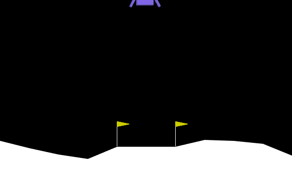
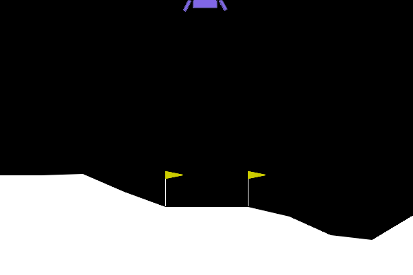
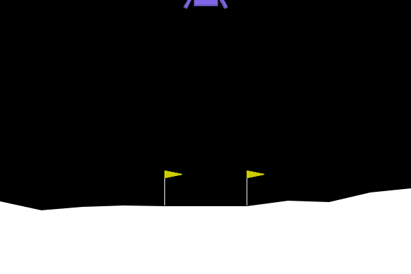
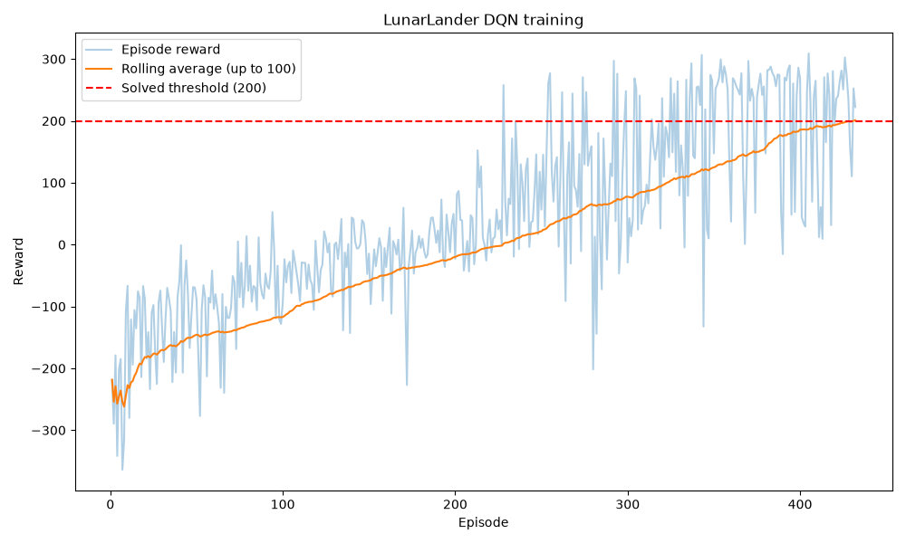

# DQN Lunar Lander

This project builds a Deep Q-Network (DQN) from scratch with PyTorch to land a
rocket in Gymnasium's LunarLander-v3 environment. It includes a random-action
baseline, training, greedy evaluation, and video recording; the trained
agent's performance should be judged from the evaluation results below.

## Demo clips

- **Before training (random agent):** Random actions; episode reward -250.36.

  

- **Mid training:** Separate DQN run after 50 training episodes; greedy demo
  reward 67.16. This is an intermediate learning example, not the final
  checkpoint used below.

  

- **Final trained agent landing on the pad:** Successful greedy episode from
  `models/dqn_best.pt`; reward 262.03.

  

## Results

Training reward plot:



Final evaluation over 10 episodes:

| Metric | Result |
|---|---|
| Mean reward | _Add result from `src/evaluate.py`_ |
| Standard deviation | _Add result from `src/evaluate.py`_ |

The environment's solved benchmark is an average reward of 200 or more over
100 episodes.

## How it works

The Q-network maps the lander's eight-number state to four action-value
estimates. The agent chooses actions with an epsilon-greedy policy and stores
experienced state/action/reward/next-state transitions in a replay buffer.
For each sampled transition, DQN compares the policy network's estimate for
the chosen action with a one-step TD target, computed using the reward and the
target network's largest next-state action value. This is semi-gradient TD:
the target is held fixed while backpropagation updates the policy network.
Random minibatches reduce correlation between consecutive environment steps,
and the separate target network helps stabilize learning.

## Setup

Use Python 3.11. Create and activate the virtual environment, then install
project dependencies:

```bash
python3.11 -m venv .venv
source .venv/bin/activate
python -m pip install -r requirements.txt
```

Video recording also requires MoviePy. Install the Gymnasium `other` extra if
it is not already available:

```bash
python -m pip install "gymnasium[other]"
```

## How to run

Run the random-action baseline, which opens a render window:

```bash
python scripts/random_agent.py
```

Train the DQN agent. Training runs for up to 1,000 episodes, saves its best
policy to `models/dqn_best.pt`, and writes `plots/training_curve.png`:

```bash
python src/train.py
```

Evaluate the saved policy over 10 episodes with exploration disabled:

```bash
python src/evaluate.py
```

Record greedy-policy episodes. Recording continues until it captures an
episode with reward at least 200, or reports failure after 100 attempts:

```bash
python src/record.py
```

Evaluation and recording need a checkpoint created by training. The network,
replay buffer, and agent also have small smoke tests:

```bash
python src/network.py
python src/replay_buffer.py
python src/agent.py
```

## Project structure

- `src/network.py` — PyTorch network that estimates four action values.
- `src/replay_buffer.py` — Stores and randomly samples transitions.
- `src/agent.py` — Epsilon-greedy action selection and DQN learning update.
- `src/train.py` — Training loop, model checkpoint, and reward plot.
- `src/evaluate.py` — Greedy evaluation of a saved checkpoint.
- `src/record.py` — Records evaluation episodes as video.
- `scripts/random_agent.py` — Random-action environment baseline.
- `models/` — Saved model checkpoints.
- `plots/` — Training reward plots.
- `videos/` — Recorded MP4 or GIF clips.
- `CLAUDE.md` — Project facts, progress log, and known issues.

## Hyperparameters

| Hyperparameter | Value |
|---|---:|
| Discount factor (gamma) | 0.99 |
| Learning rate | 0.0005 |
| Batch size | 64 |
| Replay buffer capacity | 100,000 transitions |
| Starting epsilon | 1.0 |
| Minimum epsilon | 0.01 |
| Epsilon decay per episode | 0.995 |
| Target network update interval | 1,000 learning steps |
| Hidden layers | 2 x 128 neurons, ReLU |

## Lessons learned

- A random policy is a useful baseline and setup check, but it does not learn
  from rewards or observations.
- The network's four outputs depend on its input state; before training,
  randomly initialized Q-values are not useful action recommendations.
- DQN uses past transitions as experience for TD updates, not as actions to
  imitate. Epsilon-greedy collection and the greedy TD target make it
  off-policy.
- Evaluation uses epsilon zero to measure the learned greedy policy without
  random exploration.
- Gymnasium's `RecordVideo` needs MoviePy to write MP4 clips.
